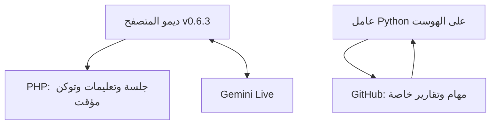
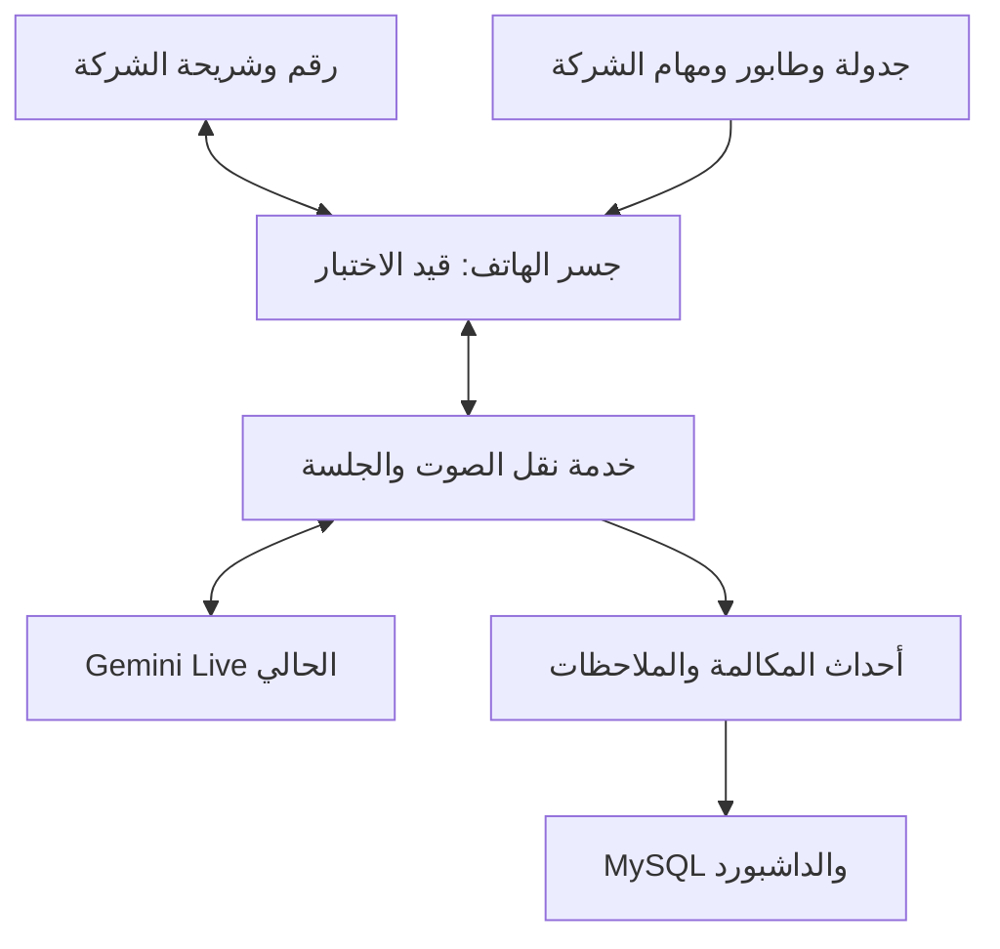

# المعمارية وحدود الأجزاء

## أحدث قرار بحثي — 30 أكتوبر 2026

Shizuku وAccessibility وأي شراء هاردوير للعميل وأي عقد/اشتراك اتصالات جديد مستبعدة صراحة. الشريحة والباقة والصوت الموجودون هم الأساس. المرشح الجديد **embedded ADB داخل APK مع مساعد shell**؛ اقتراح مشروط لا يثبت صوت هاتفنا، ولا يزيل قيود المصنع أو الإعداد الأول. بحث المصدر وجد مسار تحية في JemRec، لكنه لا يثبت حوار AI مستمرًا أو استعادة قبل أول unlock.

راجع [التقرير الموسع](../research/2026-10-30/SOFTWARE_SIM_VOICE_RESEARCH_AR.md) و[خطة إثبات الصوت](../research/2026-10-30/AUDIO_PROOF_PLAN_AR.md). الحالة PENDING_DEVICE_AUDIO_PROOF؛ لا تنفيذ تطبيق/هوست أو مكالمات في جلسة البحث.

## ما هو موجود الآن

الخط الأول مسار الديمو الحالي، والخط الثاني قناة إدارة جرى إثباتها. **ليس بينهما ناقل صوت مكالمة SIM منفذ.** getUserMedia يلتقط مدخل المتصفح؛ لا يجعل PHP أو Gemini يملكان صوت مكالمة الشبكة الخلوية.

## الوجهة المطلوبة — تصميم مشروط بإثبات الهاتف

Shizuku مستبعد. المرشح البحثي الجديد جسر embedded ADB/shell داخل تطبيقنا؛ لم ينجح بعد على الهاتف المستهدف. SIP/PBX قد يكون وسيطًا إذا احتاجه الجسر المثبت. اختيار Asterisk أو خدمة مخصصة أو لغة bridge لا يُحسم قبل اختبار الصوت وتوافق الاستضافة. LiveKit غير مطلوب في القرارات الحالية.

## فصل المسؤوليات

| المكون | المسؤولية | الحالة |
|---|---|---|
| الهاتف والشريحة | الرنين والإجابة والإنهاء، capture/injection في الاتجاهين | لم يثبت على الهاتف. |
| ناقل الصوت | تحويل format/rate، جلسة AI، interruption، reconnect/end ومزامنة الطرفين | تصميم، لا يعمل الآن. |
| منصة الأعمال | tenant/agent/task/knowledge، القوائم، الدوام، التقارير والصلاحيات | handoff + تصميم. |
| التخزين | MySQL للحالة الدائمة، ملفات معرفة/تسجيلات خاصة | مطلوب؛ لم ينشأ schema Voice إنتاجي. |
| host-link | تنفيذ أوامر تطوير/فحص مؤقتة كل دقيقة | عامل قائم ومثبت؛ ليس audio transport ولا scheduler المكالمات. |

متطلبات المنصة الأصلية Laravel/MySQL/Vue/Inertia/RTL موجودة في handoff. PHP CLI 8.1 الحالي لا يحقق حد PHP 8.3 المذكور هناك لبدء Laravel 13؛ يلزم فحص PHP web/CLI المتاحين واختيار بيئة متوافقة. لا ترقية تلقائية للديمو ولا استنتاج أن كل السيرفر يعمل على إصدار واحد.

## إعادة استخدام الكود

- `api/live_session.php`: توكن مؤقت وبناء سياق جلسة Gemini؛ يلزم فصل سياق tenant/task والتحقق من الصلاحية والاستهلاك في المنتج.
- `lib/OutboundMission.php`: صياغة المهمة والهوية والقيود؛ يعاد استخدامها مع حفظ revisions بدل النص المؤقت.
- `assets/outbound.mjs`: بدء الدور وانتظار العميل؛ يستبدل الزر اليدوي بأحداث answer الفعلية.
- `assets/app.js`: مرجع PCM وأحداث الصوت/المقاطعة؛ Web Audio وgetUserMedia ليسا جاهزين للعمل كما هما في خدمة سيرفر.
- `data/knowledge.json`: معرفة ديمو الاستضافة، لا معرفة مفروضة على كل عميل عقاري/قطاع آخر.
- الملفات القديمة `api/brain.php` و`api/tts.php` وEdgeTTS ليست مسار Gemini Live الحالي. لا نبدأ بها لمجرد أسمائها.
- اختبارات browser mock مفيدة للواجهة ولا تثبت مكالمة هاتف.

## حالة الهاتف ونتيجة الحوار

السلسلة المقترحة: pending → reserved → dialing → ringing → answered → ended، مع terminal reasons: busy/no_answer/rejected/failed/cancelled. هذه **عقود تصميم** وليست enums منشورة.

نتائج business مستقلة: interested/not_interested/callback/qualified/handoff/unknown. وجود answered لا يجعل العميل مهتمًا؛ كلام النموذج لا يثبت أن الخط أغلق. بعد ended يثبت next_eligible_at اعتمادًا على delay والجداول. يعاد التحقق قبل الطلب.

## نموذج البيانات المقترح

يستفيد من كيانات handoff، مع `tenant_id` وروابط ملكية لكل مورد:

- voice_connections، voice_numbers، voice_number_agent_bindings، voice_device_bindings، channel_capabilities.
- voice_employee_configs، voice_tasks، voice_task_revisions، voice_task_knowledge_bindings.
- contact_imports/rows، contact_lists/members، مع contacts/contact_identities القائمة في تصميم المنصة.
- voice_campaigns/targets، voice_work_schedules، voice_schedule_exceptions، voice_suppression_entries.
- voice_calls، voice_call_attempts، voice_call_events؛ transcript_segments، notes، reports، followups.
- voice_recordings وvoice_usage_events عندما تُفعّل ميزاتهما.

لا تربط schema الإنتاج بجهاز Gateway كشرط طالما النقل لم يحسم. اجعل نوع الاتصال adapter له capabilities مثبتة (inbound/outbound/audio/concurrency/recovery) دون ادعاء ميزات unsupported.

## الاعتمادية والعزل

1. حجز المحاولة داخل معاملة وقفل قبل إرسال أمر الاتصال، بمعرف ثابت للمطابقة.
2. عند timeout بعد إرسال dial لا نكرر عميانيًا؛ نطابق مع قناة الهاتف، والحالة المجهولة تبقى للمراجعة.
3. أحداث مكررة/متأخرة لا تضاعف التقرير أو الفوترة أو الرقم التالي.
4. task/knowledge revision تثبت عند بدء المحاولة؛ تعديل الحملة لا يغير مكالمة قائمة.
5. الفصل يطال الصوت وqueues وsearch وbroadcast وfiles/recordings، وليس query tenant_id وحده.
6. سياق tenant يأتي من ربط رقم موثق وصلاحية السيرفر، لا caller ID أو JSON يختاره LLM.
7. upstream AI providers/keys/models داخل OnTrack platform فقط؛ مفاتيح قناة العميل منفصلة.

## ما يحتاج قرارًا بعد الاختبار

ناقل الصوت الفعلي، موقع الخدمة طويلة التشغيل، حدود الهوست، نسخة النظام المدعومة، استعادة مساعد shell بعد reboot وأول unlock، قناة pairing/provisioning، سياسة incoming أثناء الانشغال، سعة الهاتف الفعلية، تسجيلات واحتفاظ، retry windows، تسعير/حصص. لا نعد بتجربة QR كاملة قبل معرفة ما يمكن أتمتته على الجهاز.

## أحدث قرار للمالك — 30 أكتوبر 2026

تطبيق Android يستقبل الطلبات وسكريبت الحوار والمهمة وقائمة العمل وإعداداتها من لوحة الأدمن، وهو الذي يدير دورة الاتصال والإنهاء والفاصل والرقم التالي محليًا. **لا يطلب AccessibilityService ولا يعتمد على ضغطات واجهة الهاتف.** السيرفر يحفظ الإعدادات والملكية ويمنح قائمة عمل صالحة ويستقبل الأحداث والتقارير؛ لا يلزم أن يأمر بكل رقم منفردًا كي تستمر الدورة.

اقرأ [عقد التطبيق وحدود الصلاحيات](MOBILE_EXECUTOR_CONTRACT_AR.md). التحكم بالمكالمة عبر دور الهاتف الأصلي منفصل عن تمرير صوت SIM إلى AI؛ الأخير لم يثبت، ودور Default Phone وحده لا يضمنه.
