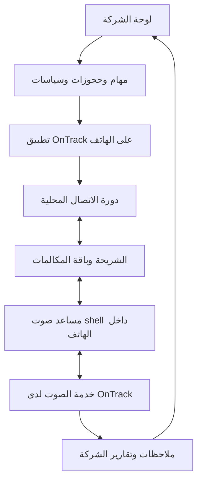

# بحث تمرير صوت AI عبر شريحة الموبايل بتطبيق برمجي

تاريخ التحقق: 30 أكتوبر 2026. المستودع: OnTrack-Development/OnTrack-voice. الحالة: **بحث ومراجعة مصدر؛ لم ننفذ اختبار صوت على هاتف المالك**.

## 1. النتيجة والاختيار المقترح

أقرب مسار يستحق اختبارًا محدودًا تحت الشروط الحالية: **APK خاص بـOnTrack يتضمن عميل ADB محليًا، ويشغّل مساعد صوت بهوية shell داخل نفس الهاتف**. ننطلق في إثبات الصوت من آليات JemRec المفتوحة، ثم نضيف البث والتحكم والحملات في تطبيقنا إذا نجح الاختبار. هذا اقتراح هندسي، وليس منتجًا يعمل الآن أو إثبات توافق Redmi Note 12 Pro 5G.

الفرق الأساسي عن المسار السابق: لا تثبيت أو اعتماد على تطبيق Shizuku، ولا إعداد SIP/PBX مطلوب لإثبات الصوت الأول. لكنه يستخدم **نفس فئة الامتياز المرتفعة: shell عبر ADB**؛ دمجه في APK لا يلغي قيود المصنع. إذا كان رفض Shizuku يشمل رفض مبدأ ADB/خيارات المطور أيضًا، فهذا المرشح لا يحقق ذلك الشرط الإضافي. لم يذكر المالك منع ADB صراحة، فلا نفترض قبوله أو رفضه.

**لم أجد دليلًا موثوقًا على حل شامل: APK عادي بصلاحيات المستخدم المعتادة يلتقط ويحقن صوت SIM على كل الهواتف.** وجود SDK أو AI أو داشبورد لا يتجاوز قيود Android. الأدلة المتاحة تثبت إمكانات على أجهزة ومسارات صوت بعينها، وتُبقي جهازنا غير محسوم.

## 2. القيود الحاكمة

| البند | الشرط الحالي |
|---|---|
| رقم الخدمة | لكل شركة رقم موبايل وشريحة وباقة موجودة تخصها؛ وارد وصادر من نفس الشريحة. |
| مكان الهاتف | ثابت على الشاحن والشبكة، والموظفون يديرون من لوحة مركزية. |
| البرمجيات المرفوضة | Shizuku وAccessibilityService وPhone Link وVoicemeeter. |
| الأجهزة | لا مطالبة العميل بشراء Gateway أو دونجل أو ESP32 أو كمبيوتر أو وصلة جسر صوت. |
| الاتصالات | لا عقد أو اشتراك جديد مع شركة اتصالات، ولا شراء دقائق CPaaS كمسار إلزامي. |
| الصوت | الصوت المستنسخ موجود ويعمل بحسب المالك؛ نعيد استخدامه، ولا نبدأ مشروع استنساخ جديد. |
| تنفيذ الحملة | التطبيق يستقبل قائمة ومهام ومعرفة وسياسات ثم ينفذ الاتصال والإنهاء والفاصل والتالي محليًا. |
| الإدارة | الشركات والموظفون والقوائم والدوام والإجازات والتقارير من الداشبورد. المدير الصوتي مؤجل. |
| الروت | لم يُعتمد تنفيذه؛ يُبحث كبديل مشروط، ولا يُستخدم أو يُطلب شراء هاتف مناسب له الآن. |

هذه التحديثات تتقدم على أي ترشيح Shizuku في الوثائق التاريخية. لا تغيير للهوست أو الهاتف أو الموقع في جلسة البحث.

## 3. لماذا طلب الرقم أسهل من تمرير الصوت؟

هناك ثلاث مسائل منفصلة: التحكم بالاتصال، استخراج صوت الطرف الآخر، وإدخال رد الإيجنت إلى ما يسمعه الطرف الآخر. دور Default Phone وInCallService يوفران أدوات للتحكم، مع أدوار وأذونات وقيود خلفية. دور الهاتف لا يمنح تلقائيًا صوت المودم. توثيق Android يضع التقاط صوت المكالمة وراء أذونات مميزة؛ RECORD_AUDIO والميكروفون وحدهما لا يثبتان ذلك. [A01–A03]

WebRTC وWebSocket وSIP ينقلون الصوت بعدما أصبح متاحًا للتطبيق؛ لا يمنحونه حق الوصول إليه. كذلك تغيير MODE_IN_COMMUNICATION وتشغيل TTS على السماعة لا يساوي توجيهه إلى telephony uplink. هذه خلاصة تحليل المعمارية وحدود الواجهات، وليست نتيجة تجربة هاتفنا.

## 4. الدليل الجديد: JemRec

المشروع Apache-2.0، ويضم عميل ADB يتصل محليًا بـ127.0.0.1 ويبدأ مساعدًا بهوية shell. الإعداد الأول يشمل خيارات المطور وWireless debugging والاقتران وإعداد استمرار التطبيق. ميزة answering machine مسجلة كاختبار على Honor عبر 2G، وعلى Galaxy S23 عبر Wi-Fi Calling؛ **ليست تجربة VoLTE على Redmi الخاص بنا**. [J01]

### ما راجعناه في الكود

المراجعة مثبتة عند commit `f011062adfb3a2154c4d5a9cc4394032fb4345f2`، لا اعتماد على وصف تسويقي وحده:

| الملف | الإشارة الفعلية | دلالة الدليل وحدوده |
|---|---|---|
| `GreetingPlayer.java:238` | يبحث عن TYPE_TELEPHONY ويستخدم setPreferredDevice مع AudioTrack بنمط MODE_STREAM. | يوجد مسار كتابة موجه إلى خرج الهاتف؛ نجاح API وحده لا يثبت أن الـHAL يرسله للمتصل. |
| `GreetingPlayer.java:264` | مسار بديل getCallUplinkInjectionAudioTrack. | حقن عبر واجهة النظام المميزة؛ يعتمد على دعم النظام والمصنع. |
| `GreetingPlayer.java:143` | اختيار مسار الحقن وكتابة PCM مع مراقبة التقدم والتوقف. | التطبيق الحالي يشغّل رسالة؛ لا يضم جسر AI شبكي مستمر جاهزًا. |
| `AnswerMachine.java` | آلة حالات للرد والتحية والرسالة والإنهاء، مع callbacks للصوت. | مرجع مفيد للتحكم؛ لا دليل على حملات AI صادرة. |
| `AdbTransport.kt:133` | pairing وهوية اتصال محفوظة، ثم اتصال ADB محلي. | لا يلزم تطبيق Shizuku منفصل؛ لا يعني صلاحيات APK عادي. |
| `BootReceiver.kt:36` | ينتظر أول unlock قبل استعادة التشغيل. | **الاستعادة غير مثبتة قبل أول فتح للقفل بعد reboot**؛ عائق مهم لتشغيل بلا تدخل. |
| `CaptureDaemon.kt` | قفل للاستعادة ومراقبة adbd وإعادة المحاولة. | يعالج حالات انقطاع معروفة؛ يحتاج اختبارًا على Xiaomi وفي الخلفية. |
| `AndroidManifest.xml` | المراجعة لم تجد تصريح BIND_ACCESSIBILITY_SERVICE أو خدمة AccessibilityService. | يطابق هذا الشرط على النسخة المقروءة، ولا يثبت أداء الصوت. |
| `NOTICE.md` | يوضح اختيار Apache-2.0 للمكتبات ذات الترخيص البديل، ومصدر أجزاء scrcpy. | قابل للبحث التجاري مع حفظ الإشعارات والتبعيات؛ لا ننسخ كود GPL من مشروع آخر ونفترض أنه Apache. |

روابط الملفات المثبتة وبصماتها في [CODE_AUDIT.json](CODE_AUDIT.json). [J02–J08]

### ما نحتاج بناءه فعلًا — اقتراحنا

بدل تحميل تحية كاملة وتشغيلها مرة واحدة: نكتب PCM الذي يصل من محرك TTS إلى buffer محدود، ثم AudioTrack الخاص بالمسار الذي نجح. وفي الاتجاه الآخر نأخذ صوت المتصل من قناة الالتقاط قبل حفظ الملف ونرسله لحظيًا. لا ننتظر نهاية التسجيل لبدء STT.

نضيف تأطيرًا للصوت، ترتيبًا وحساب زمن، تحويل sample rate، وحدود backpressure ومراقبة underrun، وflush فوري عند مقاطعة العميل. القراءة والكتابة تعملان معًا، وتغلقان عند نهاية المكالمة الحقيقية. إن كان الالتقاط يمزج رد الإيجنت مع صوت العميل، نحتاج قناة منفصلة أو معالجة مرجعية تمنع أن يجيب الإيجنت نفسه؛ لا يكفي VAD وحده لهذا الخلط.

تحويل مسار تحية إلى حوار مباشر **ليس مجرد تغيير URL**. يحتاج إثبات تشغيل متزامن وlatency ومقاطعة واستمرار عشر دقائق، ثم اختبار الصادر. هذا هو العمل الجديد المقترح، ولم يُنفذ في هذا البحث.

## 5. البدائل التي فُحصت

| المسار/المشروع | الموجود في المصدر أو وثائق المنتج | الحكم وفق شروطنا |
|---|---|---|
| JemRec + مساعد مدمج | التقاط ومشغل تحية للمكالمة وADB داخل APK؛ Apache-2.0. | المرشح الأول لاختبار الصوت، مشروط بالجهاز والإعداد الأول والتعافي. |
| Ph1nt0m-oss/Callvault | تسجيل عبر ADB مدمج؛ GPL-3.0. | مرجع التقاط وتعافٍ؛ لم نثبت حقن TTS به. ليس AI gateway جاهزًا. [G01] |
| scrcpy | مصادر تسجيل voice-call/downlink/uplink. | primitive للالتقاط؛ لا ننسب إليه حقن SIM تلقائيًا. [G02] |
| sparkcyf/android-voice-sip-agent | كود التقاط وحقن وجسر SIM/SIP بهوية shell عبر Shizuku. | **مستبعد بطلب المالك**؛ لا نعيد فرضه. [G03] |
| pulpoff/gsm2sip | حقن incall_music والتقاط على أجهزة مدعومة مع Magisk؛ MIT. | حل برمجي بامتياز root، لكنه ليس APK عاديًا ولا توافقًا مثبتًا لهاتفنا. [G04] |
| OriginStackHQ/GSM2SIP | تفصيل نتائج أجهزة ناجحة وأخرى بلا مسار حقن، وفحص policy. | دليل على اعتماد الحل على HAL؛ الترخيص الكامل غير محسوم من metadata، لا ننسخ كوده. [G05] |
| s-xander/Android-sip-gateway | root ومسار Qualcomm/إعدادات نظام محددة. | بديل مشروط غير معتمد، ليس حلًا عامًا للـMediaTek. [G06] |
| sapieonic/magick-gsm2sip | يميز التحكم دون root عن الصوت المميز مع root. | يفيد في منع الخلط بين signaling والصوت؛ لا يلغي قيد الامتياز. [G07] |
| Zerkat | برنامج تجاري مع أجهزة/root مدعومين وترخيص/تفعيل. | ليس أساسًا مفتوحًا مجانيًا عامًا للتطبيق. [G08] |
| P2P-PHONE-Call-Gateway | الفرع المقروء يستخدم microphone/acoustic bridge في وضع no-root، وتشغيل media عادي. | **ليس دليلًا على استخراج وحقن رقميين كاملين**؛ تفاصيل الكود أدناه. [G09] |
| GSMCalls | تحكم برمجي مع Smart Bridge أو PC/USB/Bluetooth كمسار صوت. | مستبعد بسبب الهاردوير/الوسيط المطلوب، رغم عنوان no-root/no-PC. [C01] |
| VMGate Cloud | FAQ يفصل SMS عن الصوت الذي يحتاج USB audio dongle. | free tier لا يلغي عتاد الصوت؛ مستبعد. [C02] |
| Asterisk chan_mobile / HFP | الكمبيوتر يعمل كطرف hands-free للهاتف. | مسار صوت مختلف فعليًا، لكنه يحتاج وسيطًا وأجهزة؛ مستبعد. [C03] |
| ESP32/HFP/oh-my-phone-use | جسر headset إلكتروني، وبعض التطبيقات المطروحة تستهدف iPhone. | مستبعد؛ لا نطلب شراءه ولو رخيصًا. [C04] |
| SIP softphone / eSIM / نقل أو إظهار الرقم | ليست بمفردها جسرًا لصوت باقة الشريحة الموجودة. | لا تحقق الحاجة وحدها. |
| تنفيذ IMS بديل داخل APK | ImsService يحتاج ثقة/إعدادًا من النظام أو المصنع/المشغل. | ليس بابًا عامًا لتطبيق ثالث؛ لا نفترض استخراج SIP credentials من SIM. [A04] |
| Device Owner/MDM أو تطبيق نظام | إدارة الجهاز لا تثبت صلاحيات صوت محمية؛ تطبيق النظام يحتاج مسار امتياز منفصل. | إعدادات إدارة وحدها لا تحل الصوت؛ توزيع privileged/OEM ليس مثبتًا لدينا. |
| مكالمات VoIP داخل تطبيقنا | يمكن التحكم في صوت الجلسة التي يملكها تطبيقنا. | مختلف عن الاتصال بأي رقم موبايل عبر باقة SIM؛ لا يفي بالمطلوب كما هو. |

### فحص ادعاء no-root في الكود

عند commit `bb82907f6cb9fc5a1afa5a30f2fd2c923bff8821` من P2P-PHONE-Call-Gateway:

- `PhoneGatewayService.kt:297–308` يصف مسار no-root بأنه ميكروفون فقط وacoustic bridge.
- `:439–455` يبني AudioTrack بـUSAGE_MEDIA؛ الجزء المقروء لا يوجه هذا التشغيل إلى TYPE_TELEPHONY كما يفعل مرشحنا.
- النتيجة من **قراءة المصدر**: لا يصح استخدام عنوان المشروع لإثبات ناقل SIM رقمي تحت شروطنا. لم نختبره على جهاز، ولا ندعي أن كل نسخ المشروع أو أجزائه متطابقة.

### ما تقول لنا التجارب المنشورة فعلًا

تقارير مشروع sparkcyf عن نجاح أجهزة أخرى تثبت أن المسألة ليست مستحيلة على كل Android، لكنها لا تثبت جهازنا، ومسار Shizuku مرفوض أصلًا. وفي تحقيق Xiaomi آخر وُثقت واجهات تعلن قابلية الاعتراض بينما مسار التسجيل/الحقن لا يتهيأ فعليًا. **نوع المعالج ونتيجة فحص API وحدهما لا يكفيان**؛ لا ننقل فشل Xiaomi17 إلى Redmi12، ولا نجاح PocoX3 إلى Redmi12. [G03، G10]

## 6. المنتج المقترح بعد نجاح الصوت

هذا رسم **تصميم مقترح**، لا يصف مكونات منفذة. محرك الصوت يمكن أن يبقى الحالي أو adapter للصوت الجاهز، أو سلسلة STT → LLM → TTS إذا أثبت القياس أنها أوفر. هذا خيار مفتوح جديد للمقارنة بطلب المالك، وليس قرار إزالة Gemini.

1. إعداد أول مرة للهاتف: تثبيت APK وربط الشركة والجهاز، الأدوار والأذونات المطلوبة، pairing محلي، ضبط autostart والبطارية، فحص الصوت. QR لا يمنح صلاحيات Android بالنيابة عن المستخدم.
2. اللوحة تستورد CSV/XLS/XLSX/TXT/لصق، وتحدد المعرفة والمهمة أو المهام والدوام والعطلات والفاصل.
3. التطبيق يستقبل دفعة موقعة منطقيًا ومرتبطة بالشركة والجهاز ونسخة المهمة وlease وstop generation. السكريبت تعليمات حوار، لا كود eval.
4. يتحقق من الوقت والإيقاف والشريحة والصوت وجاهزية AI، ثم يثبت attempt_id ويطلب الرقم.
5. لا تبدأ المحادثة عند طلب الاتصال أو سماع الرنين؛ نعتمد حدث الإجابة الحقيقي.
6. صوت العميل يصعد لخدمة الجلسة، ورد صوتنا يرجع إلى مسار الشريحة، مع الملاحظات والأحداث أثناء الحديث.
7. نهاية فعلية → تحرير جلسة الصوت → حفظ النتيجة → delay محدد → إعادة شروط الأهلية → التالي.
8. الوارد يصل إلى إيجنت الشركة نفسه عند الجاهزية. إذا الهاتف مشغول، السلوك يختبر ويعرض بوضوح؛ ثلاث مستخدمين للوحة لا يصنعون ثلاث قنوات SIM.

السيرفر يحتاج خدمة تستقبل streaming طويلًا؛ عامل GitHub/Cron الحالي ذو30ثانية للإدارة فقط. لم نثبت أن الاستضافة المشتركة الحالية تقبل هذه الخدمة. يمكننا تقييمها عند التنفيذ، ولا نخفي تكلفة أو حاجة تشغيل مركزية وراء عبارة «تطبيق وباقة فقط».

## 7. التشغيل المستمر والتعافي

| الحالة | السلوك التصميمي المطلوب | ما لم يثبت بعد |
|---|---|---|
| انقطع الإنترنت/AI | يمنع اتصالًا جديدًا؛ سياسة إنهاء مهذبة/timeout للقائم، ثم مصالحة الحالة. | مدد الاستعادة وتجربة المستخدم على الجهاز. |
| مات مساعد الصوت | health مستقل يراقب PCM فعليًا؛ توقف الحملات وإعادة تشغيل مقيدة. | إعادة التشغيل والامتياز بعد قتل العملية. |
| reboot | لا أخضر حتى عاد المساعد واختبار الصوت؛ لا إعادة طلب رقم مجهول. | JemRec الحالي ينتظر أول unlock؛ لا وعد unattended boot. |
| قفل الشاشة/توفير الطاقة | خدمة مناسبة وضبط autostart مرة واحدة؛ رصد التأخير والفشل. | Xiaomi قد يختلف عن الأجهزة المنشورة. |
| ضاعت pairing keys أو تغير نظام الهاتف | حالة SETUP_REQUIRED، لا تكرار مكالمات صامتة. | استرداد بلا لمس غير مثبت. |
| فشل التقرير | يرفع retry للتقرير وحده. | لا يعيد المكالمة بسبب فشل التلخيص. |
| وقف الحملة | stop generation يُراجع قبل كل رقم، وسياسة واضحة للقائم. | زمن التوصيل يقاس؛ heartbeat وحده لا يعطي إيقافًا فوريًا. |

مقترح فصل health إلى CONTROL_READY وSHELL_READY وAUDIO_CAPTURE_READY وAUDIO_INJECTION_VERIFIED وAI_READY وSIM_READY. كلمة ONLINE لا تكفي. مفتاح جهاز قصير النطاق وTLS وعزل جلسات الشركات ضرورية لأن هاتف shell يملك امتيازات؛ لا نعرض ADB كخدمة تحكم عامة على الإنترنت، ولا نستخدم bridge لتنفيذ أوامر shell قادمة من العملاء.

## 8. التكلفة: ليست بالضرورة 18–20 سنت للدقيقة

السعر الذي ذكره المالك سيناريو تكلفة سابق. صفحة ElevenLabs الحالية تعرض $0.08 للدقيقة الإضافية المعتادة و$0.16 للـburst، مع تكلفة LLM ومزود الاتصال منفصلتين؛ $0.80 لعشر دقائق هو **عنصر استضافة الإيجنت بتلك التعرفة**، وليس فاتورة كاملة أو سعرًا ينطبق على كل خطة. لا يلزم شراء ElevenAgents لنستخدم تطبيقنا ومحركنا. [P01]

### معادلة نظامنا

تكلفة المكالمة = نصيب الباقة/الزيادة + STT + LLM + توليد TTS الجديد + نصيب الخادم والتخزين والنقل والدعم.

امتلاك ملف صوت مستنسخ أو أوزان نموذج لا يجعل توليد كل جملة مجانيًا. كذلك الباقة الموجودة تكلفة قائمة؛ عبارة «صفر تكلفة اتصال إضافية» مشروطة بأن المكالمات داخلها، وليست حذفًا لتكلفة الباقة من حساب المشروع.

| عنصر مرجعي | وحدة السعر التي تحققنا منها | ما يجب حسابه |
|---|---|---|
| Groq Whisper v3 turbo | $0.04 لكل ساعة صوت؛ حد أدنى10ثوانٍ لكل طلب. | مجموع max(مدة القطعة،10)، مع إعادة الإرسال إن وجدت. ليس سعر ساعة مكالمات لكل المستخدمين مجتمعين. [P02] |
| Fish TTS API | $15 لكل مليون UTF-8 bytes = $0.015/1000bytes. | بايتات النص العربي المرسل، وليس عدد الحروف أو دقائق المكالمة. [P03] |
| LLM | يختلف حسب النموذج ومجموع input/output لكل طلب. | نستخدم مخصصًا افتراضيًا في المثال، لا ننسب سعرًا غير مقاس لخدمتنا. |
| TTS الحالي | المزود/تكلفة التشغيل غير موثقين في المعطيات الحالية. | نحتفظ بالصوت، ونقيس actual usage؛ Fish مقارنة سعرية فقط. |

### مثال حسابي قابل للتغيير — ليس benchmark أو عرض بيع

نفترض مكالمة10دقائق، 60قطعة STT كل منها5ثوانٍ، ونص TTS مولد حجمه5000بايت، ومخصص LLM افتراضي $0.01:

| السيناريو | STT | TTS جديد | مخصص LLM | مجموع متغير قبل الباقة والخادم |
|---|---:|---:|---:|---:|
| توليد كل النص في كل مكالمة | $0.006667 | $0.075 | $0.010 | **$0.091667 للمكالمة** |
| إعادة استخدام75% من البايتات بصوت مخزن | $0.006667 | $0.018750 | $0.010 | **$0.035417 للمكالمة** |
| إعادة استخدام90% من البايتات بصوت مخزن | $0.006667 | $0.007500 | $0.010 | **$0.024167 للمكالمة** |

هذه النتائج حساب افتراضات، وليست وعدًا بتكلفة كل مكالمة. مدة5دقائق صوت STT أصبحت10دقائق مفوترة لأن القطع قصيرة. نسبة cache تخص البايتات التي لا نرسلها للتوليد؛ ليست خصم مزود، وليست نسبة مضمونة للحوار الحر. لا نكاش معلومات شخصية أو أسعار قديمة بين الشركات. قد يزيد النص أو التلخيص أو عدد الطلبات عن المثال.

ملف [cost_model.py](cost_model.py) يعيد إنتاج المثال ويفصل مدخلات الأسعار والافتراضات. المخرجات المسجلة في [cost_scenarios.json](cost_scenarios.json). لم نستعمل سعر صرف جنيه/دولار غير متحقق؛ يمكن التحويل بسعر فعلي لاحقًا.

### المجاني والاستضافة الذاتية

- يمكن أن يكون **ترخيص كود الجسر بلا رسوم**، وتعمل الجمل المخزنة محليًا بلا طلب TTS جديد؛ يبقى التوليد المختلف والفهم والاستضافة.
- Groq له حدود حصة وطلبات؛ لا نبني خدمة عملاء غير محدودة على free tier. حدود الحساب الفعلية مقدمة على جدول عام. [P04]
- Self-host يلغي فاتورة API لذلك الجزء، ويستبدلها بحوسبة وكهرباء وصيانة وسعة. لا نفرض شراء GPU للعميل؛ أي خادم مركزي تديره OnTrack يدخل في حساب التكلفة.
- مثال استنتاج اقتصادي: خدمة STT ثابتة مفترضة $20/شهر تتعادل ماليًا مع $0.04/ساعة عند500ساعة صوت مفوترة/شهر، قبل فروق الجودة والصيانة والسعة. لذلك self-host ليس أوفر دائمًا عند البداية.
- تكلفة ثابتة مفترضة $30/شهر توزع على100مكالمة = $0.30/مكالمة، وعلى1000 = $0.03، وعلى10000 = $0.003. هذا توزيع حسابي، **لا ادعاء أن خادم $30 يتحمل10000مكالمة أو يشغّل TTS**.

## 9. STT وTTS الأقل تكلفة والعربية

| الخيار | المصدر والملاءمة | موقفنا |
|---|---|---|
| الصوت الحالي الذي جربه المالك | يعمل بحسبه؛ تكلفة ومصدر التوليد نحتاج قياسهما. | الأولوية للحفاظ عليه وإضافة streaming adapter. |
| faster-whisper | محرك MIT لتشغيل Whisper محليًا، مع CPU/GPU. | مرشح STT مركزي؛ benchmark ملفات لا يثبت latency حوارنا أو دقة المصرية. [M01] |
| whisper.cpp | تنفيذ محلي وأمثلة Android. | مسار لتخفيف API على الهاتف؛ يحتاج قياس حرارة/RAM/زمن على Note12، ولا يحل صلاحيات SIM. [M02] |
| Qwen3-ASR | كود Apache-2.0 والعربية مدرجة. | مرشح مقارنة محلي؛ نثبت ترخيص artifact والأداء والتزامن قبل اعتماده. [M03] |
| Chatterbox Multilingual | العربية مدرجة والمشروع MIT. | مرشح TTS مستضاف ذاتيًا عند الحاجة؛ المصرية وزمن أول عينة والسعة غير مقاسة. نسخة Multilingual هي المقصودة، لا Turbo الإنجليزي. [M04] |
| Fish API | مرجع تكلفة وبث وصوت متعدد اللغات. | بديل مدفوع منفصل عن ElevenAgents؛ لا يقتضي تغيير صوتنا. |
| Fish Speech المحلي | ترخيص Community للكود الحالي، مع استثناءات/شروط وأوزان قد يكون لها ترخيص مختلف. | لا نصفه بأنه Apache أو مجاني تجاريًا بلا مراجعة artifact المحدد. [M05] |
| XTTS-v2 | العربية موجودة، الأوزان CPML غير تجارية في نص الترخيص المقروء. | لا نختارها افتراضيًا لخدمة SaaS تجارية. [M06] |
| F5-TTS | الأوزان الرسمية منشورة CC-BY-NC. | ترخيص الكود لا يلغي قيد الأوزان؛ ليس الاختيار التجاري المجاني الافتراضي. [M07] |
| Qwen3-TTS الرسمي | قائمة اللغات الرسمية المقروءة لا تقدم العربية ضمن الدعم الأساسي. | لا ننسب له دعمًا عربيًا جاهزًا بسبب وجود fork أو خطة fine-tune. [M08] |
| Silero VAD | MIT؛ detector محلي للكلام، مع ONNX. | يقلل الصمت ويساعد turn-taking؛ ليس STT أو حل echo/حقن وحده. [M09] |

خطة المقارنة المقترحة: مجموعة عينات مصرية بموافقة أصحابها تشمل أسماء وأرقام وأسعار ومقاطعات ولهجات وضوضاء الهاتف، مع قياس أخطاء البيانات المهمة وزمن أول صوت وp50/p95 والتكلفة الفعلية. لا نعتمد رقم WER عام بوصفه دقة لمصر أو للعقارات. لا حاجة لتغيير محرك الصوت أثناء أول إثبات نقل؛ يمكن اختبار ملف الصوت الحالي أولًا بتكلفة AI صفر لذلك الاختبار.

## 10. اختبار يحسم المسار قبل بناء المنصة حوله

الاختبار المطلوب بالتفصيل في [AUDIO_PROOF_PLAN_AR.md](AUDIO_PROOF_PLAN_AR.md). الترتيب:

1. تسجيل النظام الفعلي وبناء الهاتف والمشغل وVoLTE/Wi-Fi Calling، ثم فحص القراءة فقط والتقاط صوت المتصل.
2. ملف من صوتنا الحالي لمدة قصيرة يمر إلى الطرف البعيد عبر الشريحة، مع كتم الميكروفون وعزل المسار الصوتي المحلي. حفظ استقبال الطرف البعيد دليلًا، لا مؤشر نجاح داخلي فقط.
3. تشغيل التقاط وحقن متزامنين، ثم حوار مستمر عشر دقائق، مع مقاطعات وإنهاء من الطرفين.
4. إثبات وارد وصادر؛ نجاح answering machine لا يغلق شرط الصادر.
5. ثلاث مكالمات اختبار متتابعة مع delay وإيقاف وbusy/no-answer ومصالحة بعد انقطاع الشبكة.
6. اختبار الشاشة المقفولة والخلفية وقتل المساعد وreboot، وبيان الاحتياج لأول unlock بوضوح.

إذا capture نجح وinjection فشل، لا نعيد تسمية ذلك نجاحًا ولا ننشر حملات صامتة. إذا فشل مسار screening نختبر incall_music فقط عند وجود دليل مسار مناسب؛ لا نكرر الإعداد نفسه بلا بيانات. وإذا فشلا على هذه النسخة من الهاتف، نسجل عدم توافق **الجهاز/البناء/نوع المكالمة** تحت القيود الحالية. لا نعود تلقائيًا إلى Shizuku أو شراء جهاز أو عقد اتصالات بعد رفضها.

## 11. القرار التنفيذي وحدود النتيجة

التوصية البحثية: **ابدأ إثبات صوت محدودًا مبنيًا على embedded ADB وآليات JemRec، ثم ابنِ تطبيق OnTrack وحملاته إذا اجتاز الاختبار**. هذا أكثر تحديدًا من إعادة محاولة pairing قديمة؛ النجاح المقاس هو أن المتصل يسمع ملفنا ويرجع صوته رقميًا في نفس المكالمة.

لم نثبت عدم إمكان أي حل مستقبلي، ولم نزعم فحص كل مستودع في العالم. البحث يغطي عائلات الحلول والمرشحين ذوي الدليل المتاح، ويفرق المصدر والتجارب المنشورة عن اختبارنا. العقبتان المفتوحتان: **صوت SIM على Redmi Note12 Pro5G، وتشغيل ثابت يتعافى بعد reboot بلا تدخل**. لا APK أو خدمة صوت أو مكالمة أو تغيير هاتف/هوست نُفذ هنا.

فهرس الروابط والقيود وتاريخ التحقق في [SOURCES.json](SOURCES.json)، والمراجعة المثبتة في [CODE_AUDIT.json](CODE_AUDIT.json). المشروع يحتفظ بحالة PENDING_DEVICE_AUDIO_PROOF.
